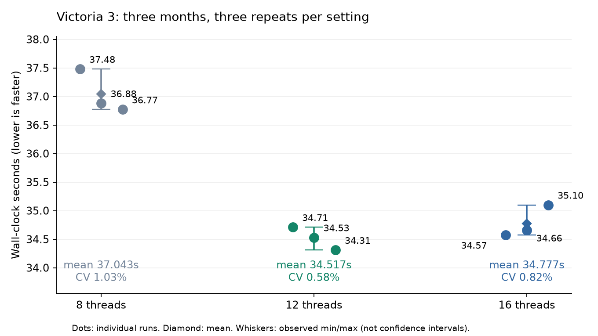

# Victoria 3：3か月・各3回の計測結果と開発判断（2026-10-05）

今回の9回では12スレッドの平均・中央値が最短。開発の診断基準を12スレッドへ更新し、16を比較対象として残す。12→16の優劣は確定せず、12～16で速度が頭打ちになる傾向として扱う。8→12の平均所要時間は6.82%短縮した。これは設定比較であり、ネイティブ最適化の実装効果ではない。

## 計測条件と履歴

ユーザーは、前回と同じセーブ、1911/3/1→6/1、TaskThreadCount以外の設定・MOD変更なし、ウォームアップ実施済みと確認した。9回の秒数はユーザー提示値をそのまま採用。実行ファイル・セーブのハッシュを今回のZIPから新たに検証したわけではない。前回の単発37.51 / 36.67 / 34.64秒は別バッチとして保存し、今回に混ぜない。warmup=falseは9件が測定本番であることを示し、ウォームアップなしを意味しない。

| TaskThreadCount | r1 / r2 / r3（秒） | 平均（秒） | 中央値（秒） | 標本標準偏差（秒） | CV |
| ---: | --- | ---: | ---: | ---: | ---: |
| 8 | 37.48 / 36.88 / 36.77 | 37.043 | 36.88 | 0.382 | 1.03% |
| 12 | 34.71 / 34.53 / 34.31 | 34.517 | 34.53 | 0.200 | 0.58% |
| 16 | 34.57 / 34.66 / 35.10 | 34.777 | 34.66 | 0.284 | 0.82% |

- 8→12：平均2.527秒、6.82%短縮。処理速度換算は7.32%増。今回の全12スレッド測定は全8スレッド測定より短い。
- 8→16：平均2.267秒、6.12%短縮。
- 12→16：平均0.260秒、0.75%増。中央値の差は0.130秒、0.38%。各群の標準偏差0.200/0.284秒と同程度で、r1では16の方が速い。
- 独立同分布・正規性を仮定した平均の参考95% t区間は12が34.019～35.014秒、16が34.072～35.481秒。各3点・手動計時・固定順序なので、この区間や低CVを有意差の証明に使わない。
- HWiNFO時刻は8の3回→12の3回→16の3回という順序を示す。温度・常駐処理・メモリ状態などの時間変化とスレッド設定が交絡し得る。全てのPC・セーブに対する最適値は決まっていない。



## 入力の重複と計測範囲

9個のZIPの各本人フォルダーからTickTask/HWiNFOを1件ずつ取り込んだ。16_r3.zipには8_r2、8_r3、12_r1～r3、16_r1～r2も含まれる。14ファイル全てが別ZIPの同名データとバイト一致したため、追加測定として数えない。CSV本体は無加工で保存しSHA-256を記録した。

8件は23,445行・368フレーム、frame 60541788～60543990。12_r2だけ23,643行・371フレームで、末尾60543996/60544002/60544008の3フレーム・198行が追加されている。共通368フレームのframe/task/callsの多重集合は全9件で完全一致した。これは状態チェックサム一致の証明ではない。

12_r2の追加部分のTickTask記録累計は57ms。**これは壁時計の追加時間ではないので、34.53秒から57msを差し引かない。** 共通範囲だけでTickTaskを再集計し、元の所要時間は保持する。12_r2を丸ごと除く感度確認でも12の平均は34.510秒、16は34.777秒で、12/16のほぼ同速という判断は変わらない。ただしこの厳密範囲一致サブセットは12が2回なので、厳密に同じログ範囲の3回反復という要件は満たさない。

既存quality gateは9件・重複runなし・CSVハッシュ一致・各群3回・CV<3%・外れ値なしで、valid=true / valid_for_performance_claim=true。現行ゲートはCSV内のframe範囲や未記入のbuild/save hashを保証しない。**ゲート通過は12が有意に速い証明ではなく、上記の範囲差と識別情報の限界を併記する。** ウォームアップ用CSVは供給されていない。

## 処理別：共通368フレームの平均記録累計

単位はms。並列処理の累計であり、壁時計時間の内訳や割合ではない。記録には整数msの量子化があるため、小さい差の解釈を控える。

| TickTask | 8 | 12 | 16 |
| --- | ---: | ---: | ---: |
| HandleAutonomousInvestment | 1664.3 | 1617.0 | 1623.3 |
| UpdatePopGrowth | 1387.7 | 1224.0 | 1228.7 |
| ProcessEconomicMigration | 959.7 | 966.3 | 984.3 |
| RecalculateModifierNodes | 1010.3 | 873.3 | 846.7 |
| UpdateEmployment | 846.7 | 841.0 | 855.3 |
| UpdateBuildingSpendingPriorities_Stage2 | 626.0 | 563.0 | 546.7 |
| UpdateStateTrades | 520.7 | 473.7 | 465.3 |
| UpdateWorldMarket | 453.0 | 414.0 | 408.3 |
| UpdateAICountryGoalsAdjustments | 322.0 | 313.0 | 321.3 |
| UpdateSpendingVariables | 300.7 | 308.0 | 307.3 |

全TickTask共通範囲の平均累計は8=12,803.0ms、12=11,379.7ms、16=11,564.0ms。民間投資は全条件で最大。人口成長は8→12で軽くなり、12→16でほぼ変化しない。修正値の再計算は16でも改善するが、経済移民・雇用・民間投資の累計は12→16で改善しない。個別処理の改善が全体の速度に直結するとは限らない。

## HWiNFO：補助診断

約2秒間隔・合計190サンプル。ログ全体は38～44秒で、34～37秒の計測開始/終了と同期するマーカーがない。平均は各run全ログの平均を3回で平均したもの。前後の一時停止や操作も含み得るので、消費エネルギーや処理効率の確定比較には使わない。

| Threads | CPU使用率（列64） | パッケージ電力 | 最高Tctl/Tdie | 物理メモリ使用率 |
| ---: | ---: | ---: | ---: | ---: |
| 8 | 34.7% | 56.5 W | 64.5 ℃ | 68.5% |
| 12 | 39.7% | 56.8 W | 63.6 ℃ | 63.7% |
| 16 | 45.2% | 62.1 W | 65.9 ℃ | 62.0% |

190サンプル全てでHTC/PROCHOT CPU/PROCHOT EXTは「いいえ」。最高温度65.9℃、最大PPT Limit79.6%。この記録範囲では熱スロットリングの兆候は得られなかった。サンプル間の短い事象までは保証しない。

16ではCPU使用率・電力が高いのに壁時計が短縮しない。これは追加ワーカーのコストやスケジューリング/待ち/キャッシュを調べる動機になるが、原因の証明ではない。8→12→16でメモリ使用率も約68.5→63.7→62.0%と変わるため、バックグラウンド状態を一定と断定しない。

HWiNFOはUTF-8 BOM付きヘッダー・末尾の再掲行と、CP932の日本語Yes/No値を含むデータ行が混在する。列位置で読むことで重複列名を保持した。「総 CPU 使用率」は列64と82の2列あり、列82は最大103.3%なので両者を同一センサーとして混ぜない。平均実効クロックは休止コア等を含み、実行中の主スレッドのクロックと同一視しない。再掲行2行/runは測定サンプルから除外した。

## 開発への反映

1. 診断基準を12へ更新し、16との比較を維持する。全ユーザー向け設定の固定やゲーム処理の変更は、このデータだけで行わない。
2. 先に取得すべきなのは12/16の同期OSプロファイル。共通の開始・終了境界を自動で記録し、実行順を12→16→16→12など交互にして時間経過の影響を減らす。サンプル取得による計測負荷も記録する。既存[OS計測手順](../../../research/os-profiling-plan.md)とnormalizer/correlatorを使う。
3. 最初の読み取り専用計測候補はHandleAutonomousInvestment、ProcessEconomicMigration、UpdateEmployment。呼出し回数、実行時間、待ち、ワーカーIDを分離し、既存のRTTI/ネイティブ対応と照合する。人口成長・修正値再計算はスケーリング比較の対照にする。
4. UpdateBuildingSpendingPriorities_Stage2のlongest_lock最大は8/12/16で93/67/53ms。OS待ちとの照合候補として残す。longest_lockをmutex待ちやクリティカルパスと断定しない。
5. 8/12/16全条件の繰り返し収集という前回の一般要求は今回で進んだ。残る境界確認は12_r2のみ。追加測定を行うなら12の共通範囲に限定し、既存9回を無駄に再収集しない。

## 再集計と保存場所

- 無加工CSV・manifest：[9回のデータ](../../../benchmarks/measured-2026-10-05-3month-repeats/)
- [詳細JSON](../../../research/generated/repeats-2026-10-05/repeat-evidence.json)、[既存ツール集計](../../../research/generated/repeats-2026-10-05/benchmark-analysis.json)、[quality](../../../research/generated/repeats-2026-10-05/quality.json)、[12スレッド対応表](../../../research/generated/repeats-2026-10-05/native-targets-t12.json)

```text
python tools/check_benchmark_quality.py benchmarks/measured-2026-10-05-3month-repeats --json local-data/repeat-quality.json --require-performance-ready
python tools/analyze_benchmarks.py benchmarks/measured-2026-10-05-3month-repeats --json local-data/repeat-analysis.json --markdown local-data/repeat-analysis.md
python tools/analyze_thread_scaling.py local-data/repeat-analysis.json --json local-data/repeat-scaling.json --markdown local-data/repeat-scaling.md
```

共通範囲の処理別集計はframe<=60543990の行を使い、run別累計の平均を求めた。壁時計の参考t区間はmean ± 4.30265273 × sample_sd / sqrt(3)。サンプル数と仮定を伴う参考表示のみ。

計算に使用した独自集計の[ソース](../../../research/generated/repeats-2026-10-05/aggregation-source.py.txt)と[レポート・図生成のソース](../../../research/generated/repeats-2026-10-05/report-chart-source.py.txt)も監査用に保存した。これらは作業時のスクリプトの写しで、汎用CLIではない。再実行する場合はROOT/REPO/DATA/OUTとZIPの場所を実行環境に合わせて指定する。標準ツールの再集計は上記コマンドを使える。図生成にはMatplotlibが必要。

保存前の検証：18 CSVの原ZIPおよびGit格納バイトとの一致、211,203行の集計、共通範囲の処理量、190 HWiNFOサンプル、20+20件のネイティブ対応、相対リンクを確認。既存ベンチマーク関連23テストが成功。独立レビューにCritical/Important指摘なし。
